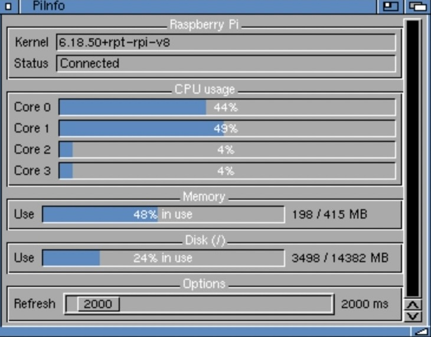

# PiInfo - Raspberry Pi System Information on Amiga

`PiInfo` is an Amiga command that displays live system statistics from the
Raspberry Pi: per-core CPU usage, memory usage, kernel version, and disk usage
of the root filesystem. If no options are specified, it prints information to the
console. If MUI is specified, it uses a MUI 3.8 user interface when
`muimaster.library` is available and otherwise falls back to a simpler GadTools/
Intuition interface. The GadTools interface can be invoked directly with the `GT`
option. PiInfo requires AmigaOS 2.04 or newer.

If using a graphical interface, the statistics refresh interval can be set in the window
using the Refresh slider, with the `REFRESH` argument when starting from a shell
(`PiInfo MUI REFRESH=2000`), or with the `REFRESH` tooltype when starting from Workbench.
The interval is given in milliseconds, from 500 to 30000, with a default of 2000.

On the Pi side, the `piinfo` service is installed by `install-pi.sh` and started
on demand by `a314d`. If `piinfo` was added to an existing `/etc/opt/a314/a314d.conf`,
restart the daemon with `sudo systemctl restart a314d`.